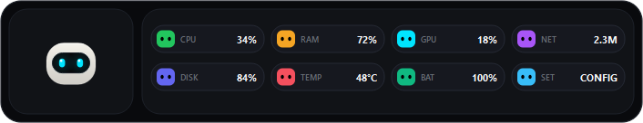
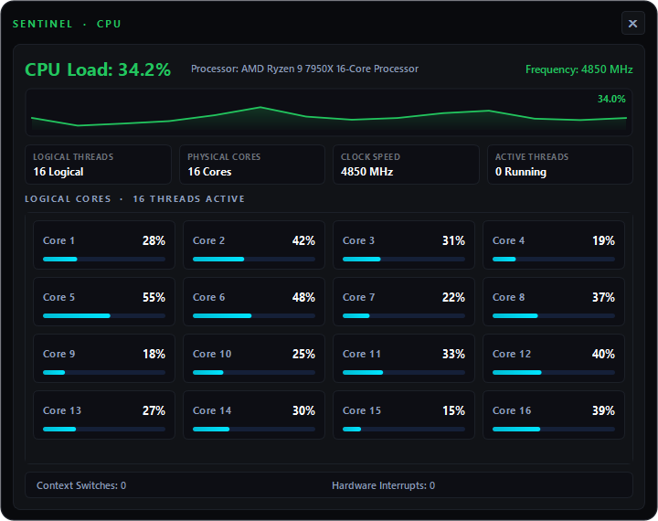
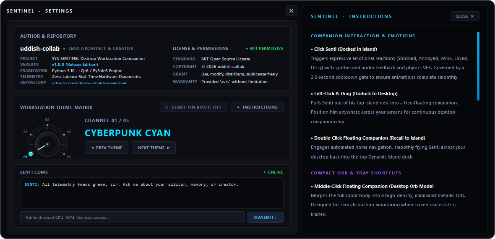
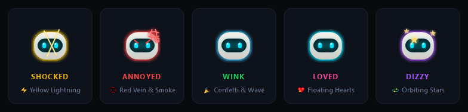

# SYS-SENTINEL 🤖⚡

<p align="center">
  <strong>An intelligent, futuristic desktop companion and zero-latency hardware telemetry HUD built with Python & Qt6 / PySide6.</strong>
</p>

<p align="center">
  
  
  
  
  
</p>

<p align="center">
  
</p>

---

## 🌟 Executive Overview

**SYS-SENTINEL** transforms system monitoring into an interactive desktop experience. It pairs an animated robotic mascot (**Senti**) with a sleek top Dynamic Island HUD, a deep-dive 8-subsystem diagnostic center, and an interactive telemetry assistant.

- **Dynamic Island HUD**: Minimalist top-of-screen bar showcasing real-time CPU, RAM, GPU, Network, Disk, Temperature, and Battery metrics.
- **Senti Mascot & Desktop Orb**: Interactive animated desktop companion featuring procedural gaze tracking, multi-click gesture shortcuts, and a compact zero-distraction metallic Orb form.
- **5 Expressive Reaction States**: Single-tap funny emotional reactions (Shocked, Annoyed, Wink, Loved, Dizzy) with mood contour glows, procedural physics VFX (lightning, smoke, hearts, stars), and polyphonic acoustic feedback.
- **Deep 8-Panel Diagnostic Matrix**: Dedicated telemetry dashboards for CPU (per-core load and live sparkline graphing), RAM, GPU, Network, Storage, Thermals, Battery, and Workstation Settings.
- **Senti Comms AI Terminal**: Natural-language telemetry interrogation console for instant diagnostic evaluations and creator lore.
- **Zero-Lag Architecture**: Optimized `--onedir` distribution without temp-directory extraction delays.

---

## 📸 Visual Showcase

<div align="center">
  <h3>Real-Time Hardware Diagnostics & Per-Core Telemetry</h3>
  
  <br/><br/>
  <h3>Workstation Command Center & Field Manual</h3>
  
  <br/><br/>
  <h3>Senti Reactive Emotions & Physics VFX</h3>
  
</div>

---

## ⌨️ Desktop Controls & Interaction Matrix

| Action | Context | Result / Behavior |
| :--- | :--- | :--- |
| **Left-Click** | Senti (Docked in Island) | Cycles through 5 funny reactions with matching synthesized audio & VFX (2s cooldown). |
| **Left-Click & Drag** | Senti (Inside Island) | Undocks Senti into a free-floating desktop companion anywhere across your screens. |
| **Double-Click** | Floating Senti | Activates thrusters, flying Senti smoothly back into the Dynamic Island dock. |
| **Middle-Click** | Floating Senti | Morphs Senti into a high-density, minimalist metallic Desktop Orb. |
| **Double-Click** | Desktop Orb | Expands the compact Orb back into the full Senti robot avatar. |
| **Single-Click** | Floating Senti / Orb | Minimizes Senti into the Windows Taskbar Notification Area (System Tray). |
| **Right-Click** | Floating Senti / Orb | Opens quick-access context menu (mode toggle, dashboard launch, recall, quit). |
| **Cursor Hover** | Any Island Telemetry Pill | Senti turns his gaze to follow your cursor position, playing musical glass chimes. |
| **Pill Click** | Any Island Telemetry Pill | Opens real-time hardware diagnostics dashboard for that subsystem. |

---

## 🚀 Getting Started

### 1. Prerequisites
- **Windows 10 or 11** (64-bit)
- **Python 3.10+**

### 2. Clone the Repository
```bash
git clone https://github.com/uddish-collab/sys-sentinel.git
cd sys-sentinel
```

### 3. Setup Virtual Environment
```bash
py -m venv .venv
.venv\Scripts\activate
```

### 4. Install Dependencies
```bash
py -m pip install -r requirements.txt
```

### 5. Launch SYS-SENTINEL
```bash
py src/senti_app.py
```

---

## 📦 Building Executable & Installer

### 1. Build Optimized Standalone Binaries
Compiles an optimized `--onedir` standalone distribution into `dist\SENTI\` with heavy unused Qt modules stripped:
```bash
build_exe.bat
```

### 2. Build Windows Setup Wizard
Compiles a full Windows setup installer (`dist\installer\Sentinel-Setup-v1.0.0.exe`) with Start menu shortcuts, uninstaller, and optional boot autostart:
```bash
build_installer.bat
```

> **SmartScreen Notice**: Because this build is open-source and unsigned, Windows SmartScreen may present a routine warning on first launch. Click **More info** → **Run anyway** to proceed.

---

## 🧪 Verification & Test Suite

SYS-SENTINEL includes 16 test suites covering telemetry polling, animation curves, companion coordination, and state management:

```bash
py -m unittest discover -s tests -v
```
*Current test pass rate: 46 / 46 tests passing.*

---

## 📁 Project Architecture

```text
sys-sentinel/
├── src/
│   ├── senti_app.py         # Application entry point, window coordinator & system tray
│   ├── senti_brain.py       # Senti Comms natural-language query evaluation engine
│   ├── senti_mascot.py      # Animated desktop pet widget, VFX particle engine & reactive eye physics
│   ├── senti_island.py      # Top Dynamic Island HUD overlay & 8-pill telemetry matrix
│   ├── senti_dashboard.py   # Full 8-tab subsystem monitor & instructions drawer
│   ├── senti_widgets.py     # Reusable custom UI components (meters, sparklines, bars)
│   ├── senti_sound.py       # Polyphonic audio synthesis & harmonic glass chimes
│   ├── senti_settings.py    # Persistent app settings, Windows registry autostart & theme matrix
│   ├── senti_state.py       # Centralized telemetry store & companion mood state
│   └── system_monitor.py    # Asynchronous background hardware metrics & thermal daemons
├── tests/                   # Comprehensive test coverage (46 tests across 8 suites)
│   ├── test_companion.py
│   ├── test_dashboard.py
│   ├── test_pill_toggle.py
│   ├── test_senti_brain.py
│   ├── test_senti_state.py
│   ├── test_sound.py
│   ├── test_system_monitor.py
│   └── test_temperature.py
├── assets/                  # High-resolution mascot icons and synthesized audio cues
├── screenshots/             # Visual previews of Island HUD, Dashboards, and VFX
├── SENTI.spec               # Optimized PyInstaller distribution specification
├── installer.iss            # Inno Setup Windows installer script
├── build_exe.bat            # Automated batch compiler for onedir binaries
├── build_installer.bat      # Automated batch compiler for setup wizard installer
├── requirements.txt         # Pinned core runtime dependencies
├── requirements-dev.txt     # Packaging dependencies
├── .gitignore
└── README.md
```

---

## 🛡️ License & Attribution

Architected and developed by **uddish-collab**.  
Distributed under the permissive **MIT License**. Free for personal, educational, and commercial usage.
