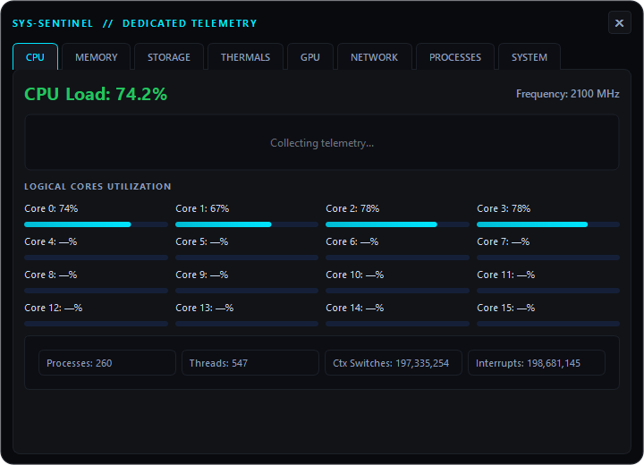
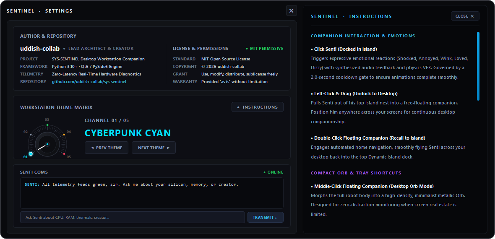
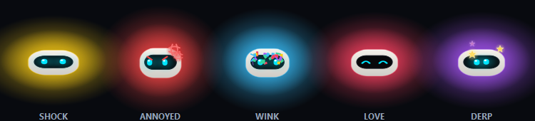

# SYS-SENTINEL 🤖⚡

**An intelligent, futuristic desktop companion and real-time hardware telemetry HUD built with Python & PySide6.**

SYS-SENTINEL reimagines system monitoring by combining a live desktop mascot ("Senti"), a sleek dynamic Top Island HUD, and a deep 8-tab subsystem analytics dashboard into an intuitive, cyberpunk-styled workstation companion.

<div align="center">
  
  <br/><br/>
  
  &nbsp;&nbsp;
  
  <br/><br/>
  
</div>

---

## 🌟 Key Features

### 🐾 Senti — The Desktop Mascot
- **Expressive Eye Physics**: Smooth gaze tracking, blinking, squinting, and reactive facial animations.
- **Hardware-Aware Mood States**: Senti dynamically reacts to real-time CPU/GPU load, memory bottlenecks, and thermal spikes.
- **Interactive & Draggable**: Hover animations, speech bubbles, and effortless desktop placement.

### 🏝️ Dynamic Top Island HUD
- **Minimalist Workstation Pill**: Unobtrusive top-of-screen bar showcasing real-time CPU, GPU, RAM, and Disk metrics.
- **Expandable Telemetry Pills**: Hover or click metrics for instant popouts, live status dots, and warnings.
- **Seamless Docking**: Automatically stays accessible without obstructing your workflow.

### 📊 Comprehensive 8-Panel Dashboard
- **Overview**: System health index, quick vitals, OS details, and uptime.
- **CPU**: Per-core breakdown, clock speeds, and live frequency graphing.
- **GPU**: NVIDIA and integrated graphics telemetry (VRAM usage, core load, temperatures).
- **RAM & Memory**: Physical memory breakdown, commit charges, and swap stats.
- **Storage**: Multi-drive capacity bars and real-time read/write disk throughput.
- **Network**: Active adapter detection, IP configs, and live upstream/downstream speedometers.
- **Processes**: Live task manager displaying top CPU and memory consumers.
- **Settings & Studio**: Customizable control center and HUD layout configuration.

### 🔊 Audio & Alert Synthesizer
- Procedural alert chimes, system sound cues, and interactive feedback.

---

## 🛠️ Tech Stack

- **Python 3.10+**
- **[PySide6](https://doc.qt.io/qtforpython-6/)** (Qt6 GUI engine, QPainter canvas, QPropertyAnimation)
- **[psutil](https://github.com/giampaolo/psutil)** (Cross-platform system hardware & process telemetry)

---

## 🚀 Getting Started

### 1. Prerequisites
Ensure you have **Python 3.10 or higher** installed on Windows.

### 2. Clone the Repository
```bash
git clone https://github.com/uddish-collab/sys-sentinel.git
cd sys-sentinel
```

### 3. Setup Virtual Environment
```bash
py -m venv .venv
.venv\Scripts\activate
```

### 4. Install Dependencies
```bash
py -m pip install -r requirements.txt
```

### 5. Launch SYS-SENTINEL
```bash
py src/senti_app.py
```

---

## 🧪 Running Tests

The test suite validates companion windows, dashboard tabs, telemetry collection, and state management:

```bash
py -m unittest discover -s tests -v
```

---

## 📦 Building Executable & Installer

### 1. Build Optimized Standalone Binaries
Compiles the `--onedir` executable distribution into `dist\SENTI\` with heavy unused Qt modules stripped:
```bash
build_exe.bat
```

### 2. Generate Windows Setup Installer
Creates a full Windows installer (`dist\installer\Sentinel-Setup-v1.0.0.exe`) with Start Menu shortcuts, uninstaller, and optional boot autostart:
```bash
build_installer.bat
```

> **Note on Windows SmartScreen**: Because this open-source build is not yet code-signed with an EV certificate, Windows SmartScreen may present a routine warning on initial launch. Click **More info** → **Run anyway** to proceed.

---

## 📁 Project Structure

```text
sys-sentinel/
├── src/
│   ├── senti_app.py         # Application entry point, window coordinator & tray
│   ├── senti_brain.py       # Senti Comms natural-language query reasoning engine
│   ├── senti_mascot.py      # Animated desktop pet widget & reactive eye physics
│   ├── senti_island.py      # Top Dynamic Island HUD overlay & telemetry pills
│   ├── senti_dashboard.py   # Full 8-tab subsystem monitor & instructions drawer
│   ├── senti_control.py     # Quick settings & companion control flyout
│   ├── senti_widgets.py     # Reusable custom UI components (meters, graphs, bars)
│   ├── senti_sound.py       # Procedural audio effects & sound feedback engine
│   ├── senti_settings.py    # Persistent app settings & user configurations
│   ├── senti_state.py       # Centralized telemetry store & companion state
│   └── system_monitor.py    # Asynchronous background hardware metrics & temp daemons
├── tests/                   # Comprehensive 16-suite unit test coverage (46 tests)
│   ├── test_companion.py
│   ├── test_dashboard.py
│   ├── test_funny_expressions.py
│   ├── test_island_drag.py
│   ├── test_mascot_eyes.py
│   ├── test_pill_toggle.py
│   ├── test_senti_brain.py
│   ├── test_senti_state.py
│   ├── test_sound.py
│   ├── test_status_dots.py
│   ├── test_system_monitor.py
│   ├── test_system_tab.py
│   ├── test_telemetry_layout.py
│   ├── test_temperature.py
│   ├── test_theme_matrix.py
│   └── test_workstation_matrix.py
├── assets/                  # High-resolution mascot icons and synthesized audio cues
├── screenshots/             # Visual previews of Island, Dashboards, and VFX
├── SENTI.spec               # Optimized PyInstaller distribution specification
├── requirements.txt         # Pinned core runtime dependencies
├── requirements-dev.txt     # Build and packaging tooling
├── .gitignore
└── README.md
```

---

## Terms of Use

Authored and maintained by uddish-collab (2026). Free for personal, educational, and commercial usage.
